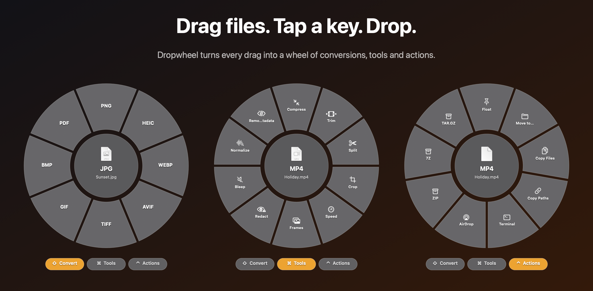
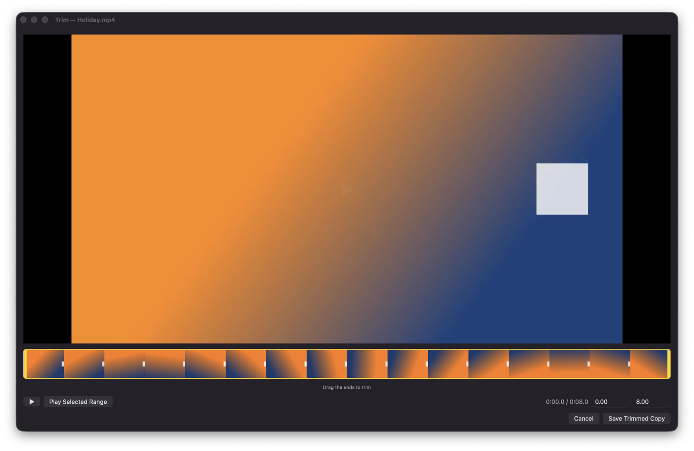
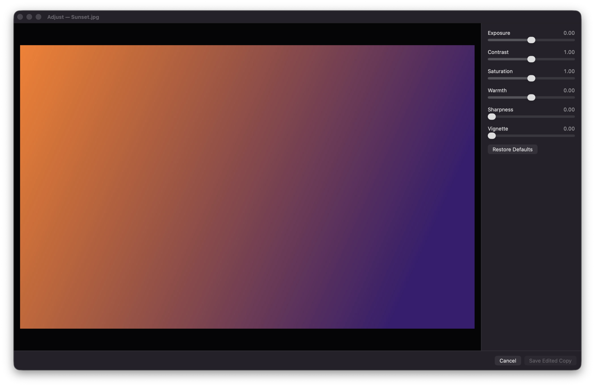

# Dropwheel

Drag files. Tap a key. Drop on a wheel to convert, edit or share them.

**[Download](https://github.com/tim-jordan-1/dropwheel/releases/latest/download/Dropwheel.zip)** · Needs macOS 14 or later and `brew install ffmpeg webp`



Dropwheel is a macOS menu-bar app that converts and processes files while you drag them. Start to drag files, then tap one key. A wheel of actions opens under the pointer. Drop the files on an action to run it.

| Key | Wheel |
|---|---|
| ⇧ Shift | Convert: image, video, audio and document formats |
| ⌘ Command | Tools: compress, resize, trim, join, and more |
| ⌃ Control | Actions: move, copy, AirDrop, ZIP, and more |

To switch wheels during a drag, tap a different key.

Tools such as Trim, Crop, Resize and Adjust open an editor first. Conversions and tools save a new file next to the original. They never overwrite it.





## Install

1. Install the media tools with [Homebrew](https://brew.sh). Dropwheel uses them for video, audio and WebP files:

   ```bash
   brew install ffmpeg webp
   ```

2. Download [Dropwheel.zip](https://github.com/tim-jordan-1/dropwheel/releases/latest/download/Dropwheel.zip).
3. Unzip it and move `Dropwheel.app` to your Applications folder.
4. Open Dropwheel. The app is not notarized by Apple, so macOS blocks it the first time.
5. Open System Settings > Privacy & Security, scroll down, and click Open Anyway next to the Dropwheel message.

If you prefer the terminal, this command removes the block instead of steps 4 and 5:

```bash
xattr -dr com.apple.quarantine /Applications/Dropwheel.app
```

Dropwheel needs macOS 14 or later. The release build runs on Apple silicon and Intel Macs.

## Quick start

1. Open Dropwheel. Its icon appears in the menu bar.
2. In Finder, start to drag a photo, and tap ⇧ Shift. Keep the mouse button down.
3. Drop the photo on PNG. The PNG file appears next to the photo.

## Build from source

You need the Xcode Command Line Tools (`xcode-select --install`).

```bash
./build.sh
open build/Dropwheel.app
```

The script also builds `build/dropwheel`, a command-line tool. Run `build/dropwheel selftest` to test the conversions.

## License

Dropwheel is under the MIT License. See [LICENSE](LICENSE).

Dropwheel does not include FFmpeg or libwebp. It runs the copies that you install with Homebrew, and those copies keep their own licenses. The Homebrew FFmpeg build includes the x264 and x265 encoders, so it is under the GNU GPL. See [THIRD_PARTY_NOTICES.md](THIRD_PARTY_NOTICES.md).
